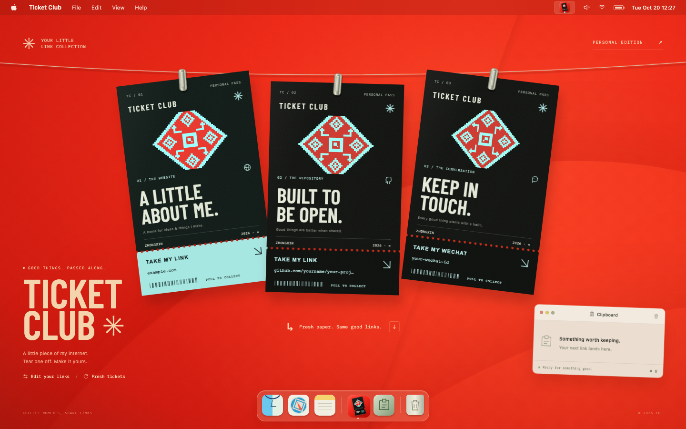

# Ticket Club

把个人网站、GitHub 仓库和微信号，印成三张可以撕下副票的分享票。朱红色 macOS 桌面、黑色纸张、冰青织纹与金属夹子。



[查看交互演示（MP4）](docs/demo.mp4)

## 启动

需要 Node.js 20.19+（20.x）或 22.12+，以及 npm。

```bash
npm install
npm run dev
```

打开 http://127.0.0.1:5178 。生产构建：`npm run build`；预览构建：`npm run preview`（4178 端口）。也可以用 `./启动.command` 一键启动。

## 使用

- 点击菜单栏票据图标或 Dock 图标，展开 / 收起晾衣绳上的票据。
- 抓住副票任意一角向下、向外拖动；25 个纸桥依次断开。松手保留已撕进度，继续拖动即可撕下。
- 最后一个纸桥断开后复制到系统剪贴板；右下角窗口显示当前页面的复制记录。系统剪贴板无法写入时会显示重试按钮。
- Tab 聚焦副票后按 Enter / 空格，也可以完成撕票；⌘ Enter 展开 / 收起；Esc 收起。
- 点击「Edit your links」编辑姓名、网站、仓库和微信号，保存在当前浏览器的本地存储。初始地址为示例，请换成真实内容。
- 票面二维码按钮可打开大二维码。二维码在浏览器本地生成，跟随链接更新。微信二维码编码的是微信号文本，不是微信的添加好友二维码。
- 「Fresh tickets」或废纸篓图标重新出票。菜单栏声音按钮控制干脆的纸张音效，默认静音。
- 手机端用 Website / GitHub / WeChat 切换票据；支持触摸拖动。遵循系统减少动态效果设置。

## 技术

Vanilla JavaScript + Vite；DOM 票面、镂空打孔遮罩、Canvas 三角网格副票。纸张自由区域保持刚性，裂口只有 9px 局部折弯，进度按纸桥离散推进、不回粘；最后断开沿用释放位置与角度。

字体、SVG、二维码库均随项目保存。运行时不依赖外部图片、字体服务、后端或二维码 API。

系统剪贴板通常要求 localhost 或 HTTPS，并受浏览器授权限制。成功状态只在实际写入成功后出现；失败保留重试入口。复制窗口展示的是本应用复制的内容，不读取其他应用的系统剪贴板历史。

## 参考与复刻边界

票面视觉参考用户提供的静态 Tickets 海报。顶部悬挂参考 Tendedero 视频：`alejandr0bujan_2107726966304690416.mp4`。

截至本版，用户引用下载会话的六段视频里没有撕票视频；最新一段是 Fluid Glass。此项目已实现完整撕票交互，并按要求改为干脆的逐孔断纸，但不能声称与缺失的撕票参考逐帧一致。详见 docs 中的分析与验证报告。补充正确视频后可继续逐帧对齐。

二维码使用 Project Nayuki MIT 实现，许可证见 `src/qr.LICENSE.txt`。字体许可证见 `public/fonts/`。
